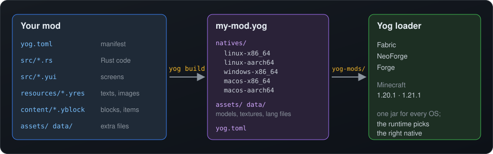

<div align="center">

<a id="top"></a>

# 🗝️ Yog

### Write Minecraft mods in Rust or Yog Script: one `.yog` file for Fabric, NeoForge and Forge

[](https://crates.io/crates/yog-api)
[](https://docs.rs/yog-api)
[](https://crates.io/crates/yog-cli)
[](https://crates.io/crates/yog-api)
[](LICENSE)
[](LICENSING.md)
[](rust-toolchain.toml)


🇺🇸 **English** | 🇷🇺 [Русский](README.ru.md)

[Overview](#-overview) • [Features](#-key-features) • [Quick Start](#-quick-start) • [Examples](#-examples) • [CLI](#-the-yog-cli) • [Architecture](#-architecture) • [Building](#-building-the-loader) • [Docs](#-documentation)

</div>

---

## 📖 Overview

**Yog** is a Minecraft mod loader for mods written in **Rust** or in **Yog
Script**. A Rust mod is a normal crate built against
[`yog-api`](https://crates.io/crates/yog-api); a Yog Script mod is `.ys` sources
that compile to JVM bytecode. `yog build` cross-compiles the natives for five
platforms, compiles the scripts once per game version, and packs everything into
one `.yog` file. Drop that file into `yog-mods/` and it runs on **Fabric,
NeoForge and Forge**, on Minecraft **1.20.1, 1.21.1 and 26.2** (1.19.2 is being
ported), on Linux, Windows and macOS.

The Java side is a thin host per loader. It forwards game events over JNI to
`yog-runtime`, a native library that loads the mods, and loads the mods' Yog
Script jars itself.

The name comes from Yog-Sothoth, "the gate and the key": the gateway between
the Java and Rust worlds.

<p align="center">
  
</p>

### 🎯 Why Yog?

- **🦀 Rust, not Java.** Mods are Rust crates with Cargo dependencies,
  `cargo test` and rustc's type checking. No Mixins and no mappings in mod code.
- **📜 Or Yog Script.** A C#-style language with Rust's enums, `match`,
  `Result` and ownership. It sees only Yog's own surface, so a script mod
  needs no Rust toolchain and no natives.
- **📦 One file for every setup.** The same `.yog` runs on three loaders, three
  Minecraft versions and five OS/CPU targets. Players install it by copying
  one file.
- **🧩 Declarative by default.** Screens are `.yui` markup with compiled
  bindings, texts and images live in `.yres` tables, and blocks and items are
  `.yblock`/`.yitem` files. Rust code is generated from all of them and
  checked by the compiler.
- **🛠️ A real toolchain.** The `yog` CLI scaffolds, builds, checks, imports
  and publishes mods. [Yog-IDLE](https://github.com/F000NKKK/Yog-IDLE) adds
  screen, book, sound, particle and video designers, a 3D block/item editor
  with paint mode, a native debugger and hot reload.
  [Yog Installer](https://github.com/F000NKKK/Yog-Installer) installs and
  updates all of it, with the JDKs and Rust.
- **🔓 Free for mods.** The API crates are `MIT OR Apache-2.0`, so a mod can
  use any license. Only the loader engine itself is AGPL
  ([LICENSING.md](LICENSING.md)).

## 🌟 Key Features

### Gameplay API
- ✅ **The bus**: every event and every action goes over one typed message
  bus. Events have a `Pre` phase that can cancel and a `Post` phase that
  observes; actions are plain functions per domain (`world::get_block`,
  `player::give_item`, `chat::broadcast`). Mods can provide services of
  their own on it
- ✅ **World, players, entities**: blocks, time, weather, inventories, NBT,
  effects, attributes, teleport across dimensions, particles, sounds
- ✅ **Commands**: plain and typed (`"float float float"`) commands
- ✅ **Content**: items, blocks, food, fuel, connecting blocks (pipes,
  fences), recipes, per-mod creative tabs
- ✅ **Redstone and block states**: power in and out, block state properties,
  regions, item cooldowns, riders, thunder
- ✅ **Dimensions**: custom dimension types with chunk generators in Rust,
  plus biomes, structures, features and mob spawning per dimension
- ✅ **Networking**: channels of bytes, and typed packets — any Yog Data
  (`Schema`) type. Sending to the server is declared in `yog.toml`
  (`[network] to_server = true`); an undeclared send is a compile error, in
  Rust and in Yog Script. Without it, a client mod joins servers that don't
  have Yog
- ✅ **Nanites**: a mod reaches the game's (or a Java mod's) classes by
  Mojang's names, private members too, through `#[nanite]` — typed, with no
  Mixins in mod code
- ✅ **Mirrors**: hot game data (blocks around the player, entities) in shared
  memory, read in place by mods and the host
- ✅ **Bodies**: skeletons and animations (`.ymodel`/`.yanim`), posing vanilla
  models, disguises and morphs, camera and movement (`yog-body`)
- ✅ **Worldgen**: declarative terrain — noise, layers, caves and ores — that
  the game generates and Yog-IDLE previews (`yog-worldgen`)
- ✅ **Persistence**: scoped key/value `Storage` (global, per player, world,
  chunk, entity) and `Config` files
- ✅ **Scheduler**: one-shot and repeating tasks in ticks
- ✅ **Inter-mod calls**: `#[yog_export]` a function, other mods call it like
  a normal crate ([`yog-interop`](https://crates.io/crates/yog-interop))

### Client, graphics and UI
- 🎨 **`yog-gfx`**: HUD and world rendering hooks with direct GPU access
  (buffers, shaders, textures) and `draw2d` — text (scaled, any font),
  rects, images and SVG, items, 3D blocks and structures, living entities —
  with a persistent shader binary cache
- 🪟 **`yog-ui`**: retained-mode UI with flexbox panels, a WPF-style `Grid`,
  scroll views, text boxes, images and focus handling, drawn with Minecraft's font
- 🧠 **`yog-kit`**: MVVM for `.yui` screens: view models, `{x:Bind}`
  bindings, commands, list views with templates, styles and visual states,
  plus a headless `TestHost` for unit tests
- 🧱 **Components**: `<Component>` `.yui` files are reusable controls with
  typed properties and events
- 🖼️ **Image aliases**: `item:apple`, `block:stone`, `sprite:icon/heart`,
  `mod:gui/logo` resolve correctly on every Minecraft version and loader
- 📚 **`yog-book`**: guide books in the look of Patchouli, drawn with
  `draw2d` alone: text, spotlight, crafting and smelting, image, entity,
  multiblock and spell-pattern pages; text flows across pages; turning
  entities and structures; the book's own texture and colors; translated
  texts and names. One renderer runs in the game and in Yog-IDLE
- 📦 **`yog-inventory`**: real container screens with custom slot layouts
- 🎬 **Media**: pictures in any format, AV1 video played on screens, in the
  world and on entities; Yog's own fonts with shaping and ligatures
  (`yog-media`, `yog-font`)

### Resources and content
- 🌍 **`.yres` resources**: texts (with culture variants such as
  `Strings.ru_ru.yres`), images, sounds, colors and numbers. One
  `yog_api::resources!()` generates typed accessors (`Strings::screen_title()`)
  and Minecraft lang files
- 🔗 **`@Set.key` references** work in `.yui`, `.yblock`/`.yitem`,
  `.ybook` and in `yog.toml` (`name = "@Strings.mod_name"`)
- ✍️ **Yog text**: one format for every text — `{b|bold}`, `{i|…}`,
  `{u|…}`, `{s|…}`, `{#8d6acc|colored}`, nested spans, `{{`/`}}` for braces —
  read the same by the Rust UI and the Java hosts
- 🧊 **`.yblock` / `.yitem`**: a block or item in one JSON file (properties,
  model, states, drops, item form). `yog build` writes the models,
  blockstates, loot tables, tags and lang entries, and `yog_api::content!()`
  registers everything
- 🍳 **`.yrecipe`**: Yog's own recipe format — shaped, shapeless,
  smelting/blasting/smoking/campfire, stonecutting, smithing, alternatives
  per ingredient, groups and categories; each host writes its Minecraft
  version's JSON
- 📕 **`.ybook`**: a guide book as a content file, its texts in `.yres`
- 📥 **Importers**: `yog import resourcepack` and `yog import bbmodel`
  (Blockbench)

### Yog Script
- 📜 **`.ys` sources**: C# syntax and naming, generics, Rust-style enums,
  `match`, `Result` and borrow checking; a `System` library written in Yog
  Script itself. Scripts see `System.Yog.*` only; game classes are reachable
  from `.yns` (nanite) files under `System.Game.*`
- 🧪 **One semantics, two runners**: `yog-script-run` interprets checked code
  (build-time macros, constants, `yog-script test`), `yog-script-java` writes
  it as Java that `javac` compiles for each game version's Java
- 🪄 **Procedural macros**: `[ProcMacro]`, `[DeriveMacro]` and attribute
  macros written in Yog Script and run at build time
- 🔌 **Rust interop**: `[Service]`, `[Event]` and `[Provide]` reach native code
  over the bus

### Developer experience
- ⚡ **Hot reload**: swap a rebuilt mod (and, if asked, its resources) into the
  running game over the control channel
- 🐞 **Native debugging**: `yog-debugger` speaks DAP on Linux (ptrace),
  Windows (the debug API) and macOS (Mach), with DWARF symbols; used by Yog-IDLE
- 🗂️ **Yog Data**: every Yog format has one data model with a binary form on
  disk and a text form for people (`yog data text`/`bin`, readable diffs
  through `yog data git`)
- 🖥️ **5-platform builds**: `cargo-zigbuild` cross-links Linux, Windows
  and macOS natives from one machine; `YOG_TARGETS` limits it for fast local builds

## 💻 Supported Platforms

| Loader | Minecraft | Toolchain | Java |
|---|---|---|:---:|
| **Fabric** | 1.19.2 *(porting)* | loader ≥ 0.15.11, fabric-api 0.77.0 | 17 |
| | 1.20.1 | loader ≥ 0.15.11, fabric-api 0.92.2 | 17 |
| | 1.21.1 | loader ≥ 0.16.9, fabric-api 0.115.6 | 21 |
| | 26.2 | Loom 1.19.1, loader ≥ 0.19.5, fabric-api 0.161.0 | 25 |
| **NeoForge** | 1.20.1 | NeoForge 47.1.106 | 17 |
| | 1.21.1 | NeoForge 21.1.77 | 21 |
| | 26.2 | NeoForge 26.2.0.93 (ModDevGradle) | 25 |
| **Forge** | 1.19.2 *(planned)* | Forge 43.x | 17 |
| | 1.20.1 | Forge 47.3.0 | 17 |
| | 1.21.1 | Forge 52.0.40 | 21 |
| | 26.2 | Forge 65.1.5 (ForgeGradle 7) | 25 |

The host code is written once and shared: `java-common/src/` holds what every
version and loader uses, and `java-common/mc/<range>/` what one Minecraft
version (or a range, named by the directory) shares across all three loaders.
A loader/version pair adds only a thin adapter under `<loader>/platforms/<mc>/`
(its entry point, event hooks and loader services) and its pins in
`<loader>/versions/<mc>.properties`. Every Fabric host compiles on Mojang's
names. 26.x builds live in each loader's `modern/` Gradle project. NeoForge
doesn't exist for 1.19.2. Yog targets the releases modders settle on; a new
Minecraft version is added once the current ones are stable.

The host-facing Java API (the bus's generated records, the shared names, the
Yog Script runtime) is its own module, `java-api/`: it is the classpath Yog
Script compiles against and is bundled into every loader jar.

A loader's network channel is optional: a client with Yog joins servers
without it, and a mod's server-bound sends are skipped there.

The runtime and every mod ship natives for **linux-x86_64, linux-aarch64,
windows-x86_64, macos-x86_64 and macos-aarch64**.

## 🚀 Quick Start

The easiest way is [Yog Installer](https://github.com/F000NKKK/Yog-Installer):
it puts the CLI, the loader SDK, Yog-IDLE, the JDKs and Rust into `~/.yog`
and keeps them updated. By hand:

```bash
cargo install --locked yog-cli      # installs the `yog` command
yog setup                  # Rust targets, Zig and cargo-zigbuild for cross builds
yog new my-mod && cd my-mod
yog build                  # -> bin/my-mod.yog
```

`yog new` creates two files. `yog.toml` replaces `Cargo.toml`:

```toml
[mod]
id          = "my-mod"
name        = "My Mod"
version     = "0.1.0"
description = "A Yog mod."
authors     = ["Your Name"]
license     = "MIT OR Apache-2.0"
```

And `src/lib.rs`:

```rust
use yog_api::{Mod, Registry, chat, event::server::life::Started};

pub struct MyMod;

impl Mod for MyMod {
    fn register(registry: &mut Registry) {
        registry.after::<Started, _>(|_, _| {
            chat::broadcast("my-mod loaded!");
        });
    }
}

yog_api::export_mod!(MyMod);
```

Copy `bin/my-mod.yog` into `<game dir>/yog-mods/` of an instance that
has the Yog loader jar installed. The log confirms it:

```
[yog] runtime initialised — the gate is open.
[yog] loaded 1 mod(s) from .../yog-mods
```

> [!NOTE]
> The runtime loads a mod built against the **same ABI major** and a minor
> **no newer than its own**: minors only add, so older mods keep loading;
> a major bump means rebuilding. `yog build` picks the newest `yog-api` from
> crates.io, which matches the newest published loader.

### The same mod in Yog Script

A mod with no `src/lib.rs` needs no Rust at all. `src/Glassy.ys`:

```csharp
mod Glassy {
    Version = "1.0.0";
    Targets = mc 1.20.1..26.2;

    const string Prefix = "g";

    // The mod's constructor runs when it loads: its subscriptions.
    Glassy() {
        Block.Break += e => {
            if (e.PlayerName.StartsWith(Prefix)) {
                new World(e.Dimension).SetBlock(e.Pos, "minecraft:glass");
            }
        };
    }
}
```

`yog check` reports its errors with the same diagnostics the editor shows;
`yog build` compiles it into `scripts/<mc>/<id>.jar` inside the `.yog`, one jar
per game version, each for that version's Java.

## 📚 Examples

### Events and commands

`before` runs before the game does it; `Flow::Cancel` stops it. Actions are plain functions (`chat::broadcast`):

```rust
use yog_api::{chat, info, Flow, Mod, Registry, event::block::Break};

impl Mod for MyMod {
    fn register(r: &mut Registry) {
        r.before::<Break, _>(|e, _| {
            if e.block_id == "minecraft:bedrock" {
                info!("Nice try, {}.", e.player_name);
                return Flow::Cancel;
            }
            Flow::Continue
        });

        r.on_command("hello", |ctx| Some(format!("Hi, {}!", ctx.source)));

        r.schedule_repeating(1200, || {
            chat::broadcast("Another minute passed.");
        });
    }
}
```

### A screen with a view model

The mod browser from [Yog-Modlist](https://github.com/F000NKKK/Yog-Modlist),
shortened. The layout and its wiring are in `src/mod_list.yui`:

```xml
<Screen id="yog-modlist:mod_list" width="400" height="224" anchor="center"
        bg="#E0101010" x:ViewModel="ModListVm">
    <Grid w="100%" h="100%" rows="20,*,Auto">
        <Row padding="0 8" gap="4" align="center" bg="#FF222222">
            <Label text="@Strings.screen.title" color="#FFD700" />
            <Spacer flex="1" />
            <Label text="{x:Bind count_text()}" color="#AAAAAA" />
        </Row>
        <Grid Grid.Row="1" rows="14,*" columns="*,*" row_spacing="4" column_spacing="6">
            <TextBox text="{x:Bind search, Mode=TwoWay}" placeholder="@Strings.search.placeholder" />
            <ListView Grid.Row="1" items="{x:Bind visible()}" key="{x:Bind id}"
                      selected="{x:Bind selected_id(), BindBack=select}" item_height="24">
                <ListView.ItemTemplate>
                    <DataTemplate x:DataType="ModEntry">
                        <Label text="{x:Bind name}" selected:color="#FFD700" />
                    </DataTemplate>
                </ListView.ItemTemplate>
            </ListView>
        </Grid>
        <Button Grid.Row="2" halign="right" text="@Strings.screen.done" command="{x:Bind cx.close()}" />
    </Grid>
</Screen>
```

The code-behind `src/mod_list.rs` is a plain struct. Bindings call its
methods, and rustc checks every one of them:

```rust
yog_api::ui_include!("mod_list");          // the generated .g.rs
use crate::res::Strings;
use yog_kit::prelude::*;

#[derive(Default)]
pub struct ModListVm { mods: Vec<ModEntry>, search: String, selected: Option<String> }

impl ViewModel for ModListVm {
    fn on_open(&mut self, _cx: &mut Cx<'_, Self>) {
        if self.mods.is_empty() { self.mods = load_mods(); }
    }
}

impl ModListVm {
    pub fn visible(&self) -> impl Iterator<Item = &ModEntry> + '_ { /* filter by search */ }
    pub fn count_text(&self) -> String { Strings::screen_count(self.mods.len()) }
    pub fn select(&mut self, id: String) { self.selected = Some(id); }
}
```

```rust
// lib.rs
mod_list::register(registry);
registry.register_menu_entry(Strings::MENU_BUTTON_KEY, mod_list::ID);
```

Scrolling, focus, keyboard navigation and text input need no code. See
[`.yui` screens](https://github.com/F000NKKK/Yog-IDLE/blob/master/docs/yui.md)
and [view-model screens](https://github.com/F000NKKK/Yog-IDLE/blob/master/docs/mvvm.md).

### Resources and translations

`resources/Strings.yres` holds the English texts, and `Strings.ru_ru.yres`
holds the Russian ones under the same names:

```json
{
  "mod_name": { "value": "Yog Mod List", "comment": "Shown in mod lists" },
  "screen.count": { "value": "{count} mods", "comment": "{count} = number of mods" },
  "menu.button": "Yog Mods"
}
```

```rust
yog_api::resources!();               // once, in lib.rs: generates `crate::res`
use res::Strings;

Strings::screen_count(42)            // "42 mods" or "Модов: 42", in the player's language
Strings::MENU_BUTTON_KEY             // the translation key, for APIs that take one
```

`yog.toml` can point at the same texts: `name = "@Strings.mod_name"`. See
[`.yres` resource files](https://github.com/F000NKKK/Yog-IDLE/blob/master/docs/yres.md).

### Blocks and items as files

A real item from [HexMod-Yog](https://github.com/F000NKKK/HexMod-Yog),
`content/items/amethyst_dust.yitem`:

```json
{
  "name": "@Items.amethyst_dust",
  "tooltip": "@Items.amethyst_dust.desc",
  "model": { "parent": "generated", "textures": { "layer0": "item/amethyst_dust.png" } }
}
```

```rust
yog_api::content!();   // in lib.rs: registers every block and item in content/
```

`yog build` writes the item model, the lang entries and the generated Rust
(`content::Items::AMETHYST_DUST`). Blocks also get blockstates, loot tables
and mining tags. See [Blocks and items](https://github.com/F000NKKK/Yog-IDLE/blob/master/docs/blocks-items.md).

### Calling another mod

[Yog-Pipes](https://github.com/F000NKKK/Yog-Pipes) exports its API with
`#[yog_export]`. Another mod depends on it through `yog.toml`:

```bash
yog add --mod yog-pipes        # adds it under [dependencies.exports]
```

```rust
use yog_pipes::{broadcast, PipePayload, PipePos};

broadcast(
    PipePos { dim: "minecraft:overworld".into(), x: 0, y: 64, z: 0 },
    PipePayload { data: vec![15], metadata: vec![] },
).unwrap();
```

The call is serialized as Yog Data and dispatched by the runtime, so the two
`cdylib`s never link to each other. The exporting mod publishes its bindings
crate with `yog publish exports`.

## 🧰 The `yog` CLI

| Command | What it does |
|---|---|
| `yog new <name>` | Create a mod project |
| `yog build [debug\|release] [--dev]` | Build for every platform, compile the scripts, and package `bin/<id>.yog` (`debug` keeps debug info for the debugger, `--dev` adds what hot reload checks) |
| `yog check` | Generate `obj/`, check the Yog Script sources, and `cargo check` for this machine |
| `yog run <loader> <mc> [--debug]` | Build, copy the `.yog` into that loader's dev game, and launch it. Targets come from the loader SDK and `~/.yog/local.toml`, never from the mod (`yog run --list`) |
| `yog ui gen` | Generate `.g.rs` from `.yui` screens and components |
| `yog res check` | Validate `.yres` files, regenerate accessors, list untranslated texts |
| `yog content check` | Validate `.yblock`/`.yitem` files, regenerate `yog-content.g.rs` |
| `yog import resourcepack <zip\|dir>` | Turn a resource pack's block/item models into `content/` files |
| `yog import bbmodel <file>` | Turn a Blockbench model into a `content/` file |
| `yog add` / `yog remove <crate>` | Edit `[dependencies]`; `--mod` edits `[dependencies.exports]` |
| `yog publish exports` | Publish the mod's `#[yog_export]` API to crates.io |
| `yog setup` / `yog doctor [--json]` | Install or report the build dependencies |
| `yog data text\|bin\|git` | Convert a Yog format's file between binary and text; make git diffs show text |
| `yog schema <format>` | A format's shape as JSON (what editors and docs are generated from) |
| `yog bench` | Run the mod's `benches/*.rs` under criterion |
| `yog control ...` | Talk to a running game over its control channel (hot reload, resource reload) |
| `yog serve` | The CLI as a service for Yog-IDLE |
| `yog designer-lib` | Build the mod for this machine only (used by Yog-IDLE's designers) |
| `yog mappings <mc> <ns> <dir>` | Write a host's name-mapping table (used by the loader builds) |

`YOG_TARGETS=linux-x86_64` (comma-separated tags or triples) builds only the
listed platforms. `YOG_API_PATH`, or `[dev] yog_api_path` in `yog.toml`,
builds against a local `yog-api` checkout instead of crates.io.

## 📐 Architecture

```mermaid
flowchart TB
    mod["Rust mod (cdylib, yog-api)<br/>packaged as .yog"]
    ys["Yog Script mod<br/>scripts/&lt;mc&gt;/&lt;id&gt;.jar in the .yog"]
    rt["yog-runtime (native library)<br/>mod loader · bus · JNI bridge"]
    host["Java host: Fabric / NeoForge / Forge<br/>(java-api + java-common + per-version Mixins)"]
    mc["Minecraft 1.20.1 / 1.21.1 / 26.2"]
    mod -- "C ABI (yog-abi): the bus" --> rt
    rt -- "JNI" --> host
    ys -- "java-api: YogServices / YogEvents" --> host
    host --> mc
```



- **The host is thin.** It extracts the runtime native embedded in the loader
  jar (`natives/<os>-<arch>/`), subscribes to the loader's events, and
  forwards them over JNI.
- **Mods are loaded dynamically** from `<game dir>/yog-mods/`. A `.yog` is a
  zip with `natives/<os>-<arch>/`, `scripts/<mc>/`, the generated `assets/`
  and `data/`, and the manifest. The runtime picks the native for the current
  machine; the host loads the script jar for the running game version.
- **The ABI is versioned** (`ABI_MAJOR * 10000 + ABI_MINOR`, in `yog-abi`).
  A mod loads when its major equals the runtime's and its minor is no newer.
- **One source for every name.** Namespaces, kinds, schemes and ids live in
  `yog-ids`; the Java (`YogNames`) and TypeScript sides are generated from it.
- **Every event carries a phase** (`Pre`/`Post`), so one registration covers
  both sides of an action.

### Crates

All crates are in `rust/crates/` and published on crates.io. Mods depend on
`yog-api` (plus `yog-kit` for view-model screens). The other API crates are
re-exported through it.

| Crate | Purpose | License |
|---|---|---|
| [`yog-api`](https://crates.io/crates/yog-api) | The facade mods use: `Mod`, `Registry`, `export_mod!`, `resources!`, `content!`, `ui_include!` | MIT/Apache |
| [`yog-kit`](https://crates.io/crates/yog-kit) | MVVM framework for `.yui` screens | MIT/Apache |
| [`yog-ui`](https://crates.io/crates/yog-ui) | Widgets, flexbox and `Grid` layout, rendering | MIT/Apache |
| [`yog-gfx`](https://crates.io/crates/yog-gfx) | GPU pipeline facade, 2D drawing, image sources | MIT/Apache |
| [`yog-book`](https://crates.io/crates/yog-book) | Guide books: format and renderer | MIT/Apache |
| `yog-core`, `yog-event`, `yog-registry`, `yog-command`, `yog-network`, `yog-storage`, `yog-config`, `yog-logging`, `yog-dimensions`, `yog-inventory`, `yog-interop` | Domain crates behind `yog-api` | MIT/Apache |
| `yog-body`, `yog-worldgen`, `yog-mirror`, `yog-media`, `yog-font`, `yog-graphics` | Bodies and morphs, declarative terrain, shared-memory mirrors, pictures and video, fonts, shared graphics primitives | MIT/Apache |
| [`yog-data`](https://crates.io/crates/yog-data), `yog-data-derive` | Yog Data: the data model, text and binary forms and schemas of every Yog format | MIT/Apache |
| `yog-ids`, `yog-formats`, `yog-sync` | Shared names (exported to Java and TS), the source formats' schemas, poison-proof locks | MIT/Apache |
| [`yog-abi`](https://crates.io/crates/yog-abi) | The `#[repr(C)]` contract between mods and the runtime | MIT/Apache |
| [`yog-cli`](https://crates.io/crates/yog-cli), `yog-home` | The `yog` command; `~/.yog` and the components Yog Installer put there | MIT/Apache |
| `yog-script-analyze` | Yog Script's lexer, parser, type and borrow checker, macros, `System` library | MIT/Apache |
| `yog-script`, `yog-script-build`, `yog-script-run`, `yog-script-java` | The `yog-script` tool, the compiler, the interpreter, the Java backend | AGPL |
| `yog-codegen`, `yog-codegen-{rust,java,typescript}`, `yog-analysis` | Toolkits for the generators and analyzers | MIT/Apache |
| [`yog-runtime`](https://crates.io/crates/yog-runtime) | The engine: JNI bridge, mod loader, the bus, control channel | AGPL |
| `yog-hot-reload`, `yog-debugger`, `yog-symbols`, `yog-mappings` | Hot reload, DAP debugger, DWARF lookups, Minecraft's name mappings | AGPL |

## 🔧 Building the Loader

You need Rust (pinned in `rust-toolchain.toml`; rustup installs the toolchain
and all five targets), `cargo-zigbuild` with Zig for the cross builds, and
JDK 17, 21 and 25 for Gradle. `build.sh` picks the JDK from
`<loader>/versions/<mc>.properties`.

```bash
./build.sh build                          # runtime for every platform + all loader jars
./build.sh build fabric --mc 1.21.1       # one loader, one Minecraft version
./build.sh build api                      # java-api (the Yog Script classpath)
./build.sh run fabric --client            # build and start the Fabric dev client
./build.sh run neoforge --client --mc 1.21.1
./build.sh test                           # cargo test
./build.sh publish fabric                 # release jar -> artifacts/fabric/
YOG_TARGETS=linux-x86_64 ./build.sh build # host platform only, much faster
```

Dev instances load mods from `<loader>/run/yog-mods/`. On the first server run,
set `eula=true` in `<loader>/run/eula.txt`.

### Hot reload

When the game starts with `YOG_CONTROL_SOCKET` and `YOG_CONTROL_TOKEN` set,
the runtime listens on that loopback TCP address, on every OS. The launcher
proves itself with the token, then sends binary Yog Data frames: list mods,
check what a new build would register differently, hot-reload a mod (its
native swapped in place, and its resources if asked), reload resources.
`yog control` speaks it from a shell. The new build must be ABI-compatible
with the runtime, so build mods that use new API against the same checkout
(`YOG_API_PATH`). Yog-IDLE does all of this from its Run toolbar.

## 📖 Documentation

| Topic | Where |
|---|---|
| Full Rust API | [docs.rs/yog-api](https://docs.rs/yog-api), [docs.rs/yog-kit](https://docs.rs/yog-kit), [docs.rs/yog-ui](https://docs.rs/yog-ui) |
| `.yui` screens, `Grid`, images, components | [Yog-IDLE/docs/yui.md](https://github.com/F000NKKK/Yog-IDLE/blob/master/docs/yui.md) |
| View-model screens (yog-kit) | [Yog-IDLE/docs/mvvm.md](https://github.com/F000NKKK/Yog-IDLE/blob/master/docs/mvvm.md) |
| `.yres` resources and translations | [Yog-IDLE/docs/yres.md](https://github.com/F000NKKK/Yog-IDLE/blob/master/docs/yres.md) |
| `.yblock` / `.yitem` content | [Yog-IDLE/docs/blocks-items.md](https://github.com/F000NKKK/Yog-IDLE/blob/master/docs/blocks-items.md) |
| Design notes (yog-kit, nanites, …) | [docs/design/](docs/design/) |
| Inventory design | [rust/crates/yog-inventory/DESIGN.md](rust/crates/yog-inventory/DESIGN.md) |
| Licensing | [LICENSING.md](LICENSING.md) |

## 🌐 The Yog Ecosystem

| Project | What |
|---|---|
| **Yog-Mod-Loader** (this repo) | Loader hosts, runtime, API crates, `yog` CLI |
| [Yog-IDLE](https://github.com/F000NKKK/Yog-IDLE) | IDE for Yog mods: screen, book and media designers, 3D block/item editor, debugger, hot reload |
| [Substrate-Platform](https://github.com/F000NKKK/Substrate-Platform) | The generic IDE core Yog-IDLE is built on |
| [Yog-Installer](https://github.com/F000NKKK/Yog-Installer) | Installs and updates Yog-IDLE, the CLI, the loader SDK, JDKs and Rust |
| [Yog-Modlist](https://github.com/F000NKKK/Yog-Modlist) | In-game mod browser; the reference view-model screen |
| [Yog-Pipes](https://github.com/F000NKKK/Yog-Pipes) | Payload-agnostic pipe networks for other mods |
| [HexMod-Yog](https://github.com/F000NKKK/HexMod-Yog) | A port of Hex Casting to Yog, with its whole guide book |
| [Yog-VLSI](https://github.com/F000NKKK/Yog-VLSI) | Redstone microchips simulated by a Rust VM |
| [Yog-Argus](https://github.com/F000NKKK/Yog-Argus) | A client bot: x-ray, Baritone's pathing and mining ported to Yog, aim and defense |

## 🚧 Status

Yog is in **active development** and nothing is API-frozen. There is no
backward compatibility between versions: old APIs and formats are removed,
not deprecated. The core is complete and runs on all nine loader/version
pairs; 1.19.2 (Fabric and Forge) is being ported, and the API surface keeps
growing.

## 📄 License

Split so the loader stays free while mods can use any license (see
[LICENSING.md](LICENSING.md)):

- **Loader engine**: the Java hosts, `yog-runtime`, `yog-hot-reload`,
  `yog-debugger`, `yog-symbols`, `yog-mappings` and the Yog Script compiler
  crates are **AGPL-3.0-only** ([LICENSE](LICENSE)).
- **Mod-facing crates**: `yog-api`, `yog-kit`, the domain crates and `yog-cli`
  are **MIT OR Apache-2.0** ([LICENSE-MIT](LICENSE-MIT), [LICENSE-APACHE](LICENSE-APACHE)).

---

<div align="center">

**[⬆ Back to Top](#top)**

Free and open source, with no paid tiers.

</div>
