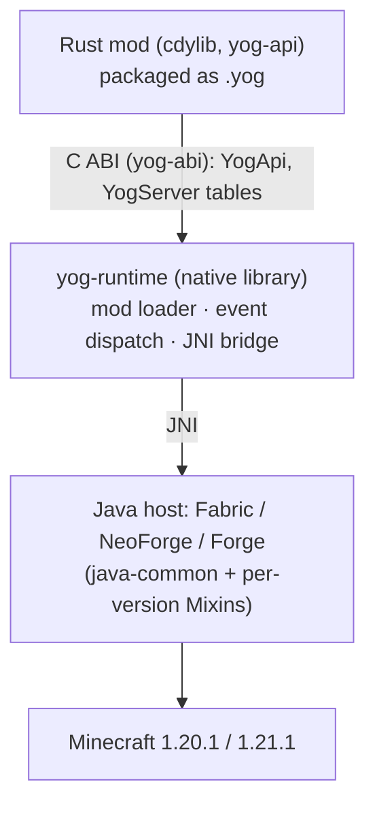

<div align="center">

<a id="top"></a>

# 🗝️ Yog

### Write Minecraft mods in Rust: one `.yog` file for Fabric, NeoForge and Forge

[](https://crates.io/crates/yog-api)
[](https://docs.rs/yog-api)
[](https://crates.io/crates/yog-cli)
[](https://crates.io/crates/yog-api)
[](LICENSE)
[](LICENSING.md)
[](rust-toolchain.toml)


🇺🇸 **English** | 🇷🇺 [Русский](README.ru.md)

[Overview](#-overview) • [Features](#-key-features) • [Quick Start](#-quick-start) • [Examples](#-examples) • [CLI](#-the-yog-cli) • [Architecture](#-architecture) • [Building](#-building-the-loader) • [Docs](#-documentation)

</div>

---

## 📖 Overview

**Yog** is a Minecraft mod loader for mods written in **Rust**. A mod is a
normal Rust crate built against [`yog-api`](https://crates.io/crates/yog-api);
`yog build` cross-compiles it for five platforms and packs everything into one
`.yog` file. Drop that file into `yog-mods/` and it runs on **Fabric,
NeoForge and Forge**, on Minecraft **1.20.1 and 1.21.1**, on Linux, Windows
and macOS.

The Java side is a thin host per loader. It forwards game events over JNI to
`yog-runtime`, a native library that loads the mods. All mod logic is Rust.

The name comes from Yog-Sothoth, "the gate and the key": the gateway between
the Java and Rust worlds.

<p align="center">
  
</p>

### 🎯 Why Yog?

- **🦀 Rust, not Java.** Mods are Rust crates with Cargo dependencies,
  `cargo test` and rustc's type checking. No Mixins and no mappings in mod code.
- **📦 One file for every setup.** The same `.yog` runs on three loaders, two
  Minecraft versions and five OS/CPU targets. Players install it by copying
  one file.
- **🧩 Declarative by default.** Screens are `.yui` markup with compiled
  bindings, texts and images live in `.yres` tables, and blocks and items are
  `.yblock`/`.yitem` files. Rust code is generated from all of them and
  checked by the compiler.
- **🛠️ A real toolchain.** The `yog` CLI scaffolds, builds, checks, imports
  and publishes mods. [Yog-IDLE](https://github.com/F000NKKK/Yog-IDLE) adds a
  screen designer, a 3D block/item editor with paint mode, a native debugger
  and hot reload.
- **🔓 Free for mods.** The API crates are `MIT OR Apache-2.0`, so a mod can
  use any license. Only the loader engine itself is AGPL
  ([LICENSING.md](LICENSING.md)).

## 🌟 Key Features

### Gameplay API
- ✅ **Events**: about 25 server events (block break/place, chat, damage,
  death, explosions, pickups, containers, projectiles...), each with a `Pre`
  phase that can cancel and a `Post` phase that observes, through one handler
- ✅ **World, players, entities**: blocks, time, weather, inventories, NBT,
  effects, attributes, teleport across dimensions, particles, sounds
- ✅ **Commands**: plain and typed (`"float float float"`) commands
- ✅ **Content**: items, blocks, food, fuel, connecting blocks (pipes,
  fences), shaped/shapeless/furnace recipes, per-mod creative tabs
- ✅ **Dimensions**: custom dimension types with chunk generators in Rust
- ✅ **Networking**: raw-byte channels and typed `packet!` structs
- ✅ **Persistence**: scoped key/value `Storage` (global, per player, world,
  chunk, entity) and `Config` files
- ✅ **Scheduler**: one-shot and repeating tasks in ticks
- ✅ **Inter-mod calls**: `#[yog_export]` a function, other mods call it like
  a normal crate ([`yog-interop`](https://crates.io/crates/yog-interop))

### Client, graphics and UI
- 🎨 **`yog-gfx`**: HUD and world rendering hooks with direct GPU access
  (buffers, shaders, textures) and a 2D helper, with a persistent shader binary cache
- 🪟 **`yog-ui`**: retained-mode UI with flexbox panels, a WPF-style `Grid`,
  scroll views, text boxes, images and focus handling, drawn with Minecraft's font
- 🧠 **`yog-kit`**: MVVM for `.yui` screens: view models, `{x:Bind}`
  bindings, commands, list views with templates, styles and visual states,
  plus a headless `TestHost` for unit tests
- 🧱 **Components**: `<Component>` `.yui` files are reusable controls with
  typed properties and events
- 🖼️ **Image aliases**: `item:apple`, `block:stone`, `sprite:icon/heart`,
  `mod:gui/logo` resolve correctly on every Minecraft version and loader
- 📚 **`yog-book`**: Patchouli-style in-game books (9 page types, recipes,
  macros, themes, custom fonts, translated texts)
- 📦 **`yog-inventory`**: real container screens with custom slot layouts

### Resources and content
- 🌍 **`.yres` resources**: texts (with culture variants such as
  `Strings.ru_ru.yres`), images, sounds, colors and numbers. One
  `yog_api::resources!()` generates typed accessors (`Strings::screen_title()`)
  and Minecraft lang files
- 🔗 **`@Set.key` references** work in `.yui`, `.yblock`/`.yitem` and in
  `yog.toml` (`name = "@Strings.mod_name"`)
- 🧊 **`.yblock` / `.yitem`**: a block or item in one JSON file (properties,
  model, states, drops, item form). `yog build` writes the models,
  blockstates, loot tables, tags and lang entries, and `yog_api::content!()`
  registers everything
- 📥 **Importers**: `yog import resourcepack` and `yog import bbmodel`
  (Blockbench)

### Developer experience
- ⚡ **Hot reload**: swap a rebuilt mod into the running game over a control socket
- 🐞 **Native debugging**: `yog-debugger` (ptrace, DAP) with DWARF symbols, used by Yog-IDLE
- 🖥️ **5-platform builds**: `cargo-zigbuild` cross-links Linux, Windows
  and macOS natives from one machine; `YOG_TARGETS` limits it for fast local builds

## 💻 Supported Platforms

| Loader | Minecraft | Toolchain | Java |
|---|---|---|:---:|
| **Fabric** | 1.20.1 | Yarn 1.20.1+build.10, loader ≥ 0.15.11, fabric-api 0.92.2 | 17 |
| | 1.21.1 | Yarn 1.21.1+build.3, loader ≥ 0.16.9, fabric-api 0.115.6 | 21 |
| **NeoForge** | 1.20.1 | NeoForge 47.1.106 | 17 |
| | 1.21.1 | NeoForge 21.1.77 | 21 |
| **Forge** | 1.20.1 | Forge 47.3.0 | 17 |
| | 1.21.1 | Forge 52.0.40 | 21 |

Each loader/version pair has its own source tree under
`<loader>/platforms/<mc>/` and its pins in `<loader>/versions/<mc>.properties`.
Code shared by all loaders lives in `java-common/`. Yog targets the `.1`
releases that modders settle on; a new Minecraft version is added once the
current ones are stable.

The runtime and every mod ship natives for **linux-x86_64, linux-aarch64,
windows-x86_64, macos-x86_64 and macos-aarch64**.

## 🚀 Quick Start

```bash
cargo install yog-cli      # installs the `yog` command
yog setup                  # Rust targets, Zig and cargo-zigbuild for cross builds
yog new my-mod && cd my-mod
yog build                  # -> artifacts/my-mod.yog
```

`yog new` creates two files. `yog.toml` replaces `Cargo.toml`:

```toml
[mod]
id          = "my-mod"
name        = "My Mod"
version     = "0.1.0"
description = "A Yog mod."
authors     = ["Your Name"]
license     = "MIT OR Apache-2.0"
```

And `src/lib.rs`:

```rust
use yog_api::{Mod, Registry};

pub struct MyMod;

impl Mod for MyMod {
    fn register(registry: &mut Registry) {
        registry.on_server_started(|srv| {
            srv.broadcast("my-mod loaded!");
        });
    }
}

yog_api::export_mod!(MyMod);
```

Copy `artifacts/my-mod.yog` into `<game dir>/yog-mods/` of an instance that
has the Yog loader jar installed. The log confirms it:

```
[yog] runtime initialised — the gate is open.
[yog] loaded 1 mod(s) from .../yog-mods
```

> [!NOTE]
> The runtime loads a mod only if both were built against the **same ABI
> version**. `yog build` picks the newest `yog-api` from crates.io, which
> matches the newest published loader. After a loader update, rebuild your mods.

## 📚 Examples

### Events and commands

One handler gets both phases. Returning `false` in `Pre` cancels the action:

```rust
use yog_api::{info, EventPhase, Mod, Registry};

impl Mod for MyMod {
    fn register(r: &mut Registry) {
        r.on_block_break(|e, phase, _srv| {
            if phase == EventPhase::Pre && e.block_id == "minecraft:bedrock" {
                info!("Nice try, {}.", e.player_name);
                return false; // cancel
            }
            true
        });

        r.on_command("hello", |ctx, _srv| Some(format!("Hi, {}!", ctx.source)));

        r.schedule_repeating(1200, |srv| srv.broadcast("Another minute passed."));
    }
}
```

### A screen with a view model

The mod browser from [Yog-Modlist](https://github.com/F000NKKK/Yog-Modlist),
shortened. The layout and its wiring are in `src/mod_list.yui`:

```xml
<Screen id="yog-modlist:mod_list" width="400" height="224" anchor="center"
        bg="#E0101010" x:ViewModel="ModListVm">
    <Grid w="100%" h="100%" rows="20,*,Auto">
        <Row padding="0 8" gap="4" align="center" bg="#FF222222">
            <Label text="@Strings.screen.title" color="#FFD700" />
            <Spacer flex="1" />
            <Label text="{x:Bind count_text()}" color="#AAAAAA" />
        </Row>
        <Grid Grid.Row="1" rows="14,*" columns="*,*" row_spacing="4" column_spacing="6">
            <TextBox text="{x:Bind search, Mode=TwoWay}" placeholder="@Strings.search.placeholder" />
            <ListView Grid.Row="1" items="{x:Bind visible()}" key="{x:Bind id}"
                      selected="{x:Bind selected_id(), BindBack=select}" item_height="24">
                <ListView.ItemTemplate>
                    <DataTemplate x:DataType="ModEntry">
                        <Label text="{x:Bind name}" selected:color="#FFD700" />
                    </DataTemplate>
                </ListView.ItemTemplate>
            </ListView>
        </Grid>
        <Button Grid.Row="2" halign="right" text="@Strings.screen.done" command="{x:Bind cx.close()}" />
    </Grid>
</Screen>
```

The code-behind `src/mod_list.rs` is a plain struct. Bindings call its
methods, and rustc checks every one of them:

```rust
yog_api::ui_include!("mod_list");          // the generated .g.rs
use crate::res::Strings;
use yog_kit::prelude::*;

#[derive(Default)]
pub struct ModListVm { mods: Vec<ModEntry>, search: String, selected: Option<String> }

impl ViewModel for ModListVm {
    fn on_open(&mut self, _cx: &mut Cx<'_, Self>) {
        if self.mods.is_empty() { self.mods = load_mods(); }
    }
}

impl ModListVm {
    pub fn visible(&self) -> impl Iterator<Item = &ModEntry> + '_ { /* filter by search */ }
    pub fn count_text(&self) -> String { Strings::screen_count(self.mods.len()) }
    pub fn select(&mut self, id: String) { self.selected = Some(id); }
}
```

```rust
// lib.rs
mod_list::register(registry);
registry.register_menu_entry(Strings::MENU_BUTTON_KEY, mod_list::ID);
```

Scrolling, focus, keyboard navigation and text input need no code. See
[`.yui` screens](https://github.com/F000NKKK/Yog-IDLE/blob/master/docs/yui.md)
and [view-model screens](https://github.com/F000NKKK/Yog-IDLE/blob/master/docs/mvvm.md).

### Resources and translations

`resources/Strings.yres` holds the English texts, and `Strings.ru_ru.yres`
holds the Russian ones under the same names:

```json
{
  "mod_name": { "value": "Yog Mod List", "comment": "Shown in mod lists" },
  "screen.count": { "value": "{count} mods", "comment": "{count} = number of mods" },
  "menu.button": "Yog Mods"
}
```

```rust
yog_api::resources!();               // once, in lib.rs: generates `crate::res`
use res::Strings;

Strings::screen_count(42)            // "42 mods" or "Модов: 42", in the player's language
Strings::MENU_BUTTON_KEY             // the translation key, for APIs that take one
```

`yog.toml` can point at the same texts: `name = "@Strings.mod_name"`. See
[`.yres` resource files](https://github.com/F000NKKK/Yog-IDLE/blob/master/docs/yres.md).

### Blocks and items as files

A real item from [HexMod-Yog](https://github.com/F000NKKK/HexMod-Yog),
`content/items/amethyst_dust.yitem`:

```json
{
  "name": "@Items.amethyst_dust",
  "tooltip": "@Items.amethyst_dust.desc",
  "model": { "parent": "generated", "textures": { "layer0": "item/amethyst_dust.png" } }
}
```

```rust
yog_api::content!();   // in lib.rs: registers every block and item in content/
```

`yog build` writes the item model, the lang entries and the generated Rust
(`content::Items::AMETHYST_DUST`). Blocks also get blockstates, loot tables
and mining tags. See [Blocks and items](https://github.com/F000NKKK/Yog-IDLE/blob/master/docs/blocks-items.md).

### Calling another mod

[Yog-Pipes](https://github.com/F000NKKK/Yog-Pipes) exports its API with
`#[yog_export]`. Another mod depends on it through `yog.toml`:

```bash
yog add --mod yog-pipes        # adds it under [dependencies.exports]
```

```rust
use yog_pipes::{broadcast, PipePayload, PipePos};

broadcast(
    PipePos { dim: "minecraft:overworld".into(), x: 0, y: 64, z: 0 },
    PipePayload { data: vec![15], metadata: vec![] },
).unwrap();
```

The call is serialized with rkyv and dispatched by the runtime, so the two
`cdylib`s never link to each other. The exporting mod publishes its bindings
crate with `yog publish exports`.

## 🧰 The `yog` CLI

| Command | What it does |
|---|---|
| `yog new <name>` | Create a mod project |
| `yog build` / `yog build debug` | Build for every platform and package `artifacts/<id>.yog` (`debug` keeps debug info for the debugger) |
| `yog check` | Generate `.yog-build/` and `cargo check` for the host only |
| `yog run <config> [--debug]` | Build, copy the `.yog` into an instance, and launch it (`[run.<config>]` in `yog.toml`) |
| `yog ui gen` | Generate `.g.rs` from `.yui` screens and components |
| `yog res check` | Validate `.yres` files, regenerate accessors, list untranslated texts |
| `yog content check` | Validate `.yblock`/`.yitem` files, regenerate `yog-content.g.rs` |
| `yog import resourcepack <zip\|dir>` | Turn a resource pack's block/item models into `content/` files |
| `yog import bbmodel <file>` | Turn a Blockbench model into a `content/` file |
| `yog add` / `yog remove <crate>` | Edit `[dependencies]`; `--mod` edits `[dependencies.exports]` |
| `yog publish exports` | Publish the mod's `#[yog_export]` API to crates.io |
| `yog setup` / `yog doctor [--json]` | Install or report the build dependencies |
| `yog designer-lib` | Build the mod for this machine only (used by Yog-IDLE's designer) |

`YOG_TARGETS=linux-x86_64` (comma-separated tags or triples) builds only the
listed platforms. `YOG_API_PATH`, or `[dev] yog_api_path` in `yog.toml`,
builds against a local `yog-api` checkout instead of crates.io.

## 📐 Architecture



- **The host is thin.** It extracts the runtime native embedded in the loader
  jar (`natives/<os>-<arch>/`), subscribes to the loader's events, and
  forwards them over JNI.
- **Mods are loaded dynamically** from `<game dir>/yog-mods/`. A `.yog` is a
  zip with `natives/<os>-<arch>/`, the generated `assets/` and `data/`, and the
  manifest. The runtime picks the native for the current machine.
- **The ABI is versioned** (`ABI_MAJOR * 10000 + ABI_MINOR`, in `yog-abi`).
  A mod loads only when its version equals the runtime's.
- **Every event carries a phase** (`Pre`/`Post`), so one registration covers
  both sides of an action.

### Crates

All crates are in `rust/crates/` and published on crates.io. Mods depend on
`yog-api` (plus `yog-kit` for view-model screens). The other API crates are
re-exported through it.

| Crate | Purpose | License |
|---|---|---|
| [`yog-api`](https://crates.io/crates/yog-api) | The facade mods use: `Mod`, `Registry`, `export_mod!`, `resources!`, `content!`, `ui_include!` | MIT/Apache |
| [`yog-kit`](https://crates.io/crates/yog-kit) | MVVM framework for `.yui` screens | MIT/Apache |
| [`yog-ui`](https://crates.io/crates/yog-ui) | Widgets, flexbox and `Grid` layout, rendering | MIT/Apache |
| [`yog-gfx`](https://crates.io/crates/yog-gfx) | GPU pipeline facade, 2D drawing, image sources | MIT/Apache |
| [`yog-book`](https://crates.io/crates/yog-book) | In-game books | MIT/Apache |
| `yog-core`, `yog-event`, `yog-world`, `yog-player`, `yog-entity`, `yog-registry`, `yog-command`, `yog-network`, `yog-storage`, `yog-config`, `yog-logging`, `yog-dimensions`, `yog-inventory`, `yog-interop` | Domain crates behind `yog-api` | MIT/Apache |
| [`yog-abi`](https://crates.io/crates/yog-abi) | The `#[repr(C)]` contract between mods and the runtime | MIT/Apache |
| [`yog-cli`](https://crates.io/crates/yog-cli) | The `yog` command | MIT/Apache |
| [`yog-runtime`](https://crates.io/crates/yog-runtime) | The engine: JNI bridge, mod loader, dispatch, control socket | AGPL |
| `yog-hot-reload`, `yog-debugger`, `yog-symbols` | Hot reload, ptrace/DAP debugger, DWARF lookups | AGPL |

## 🔧 Building the Loader

You need Rust (pinned in `rust-toolchain.toml`; rustup installs the toolchain
and all five targets), `cargo-zigbuild` with Zig for the cross builds, and
JDK 17 and 21 for Gradle. `build.sh` picks the JDK from
`<loader>/versions/<mc>.properties`.

```bash
./build.sh build                          # runtime for every platform + all loader jars
./build.sh build fabric --mc 1.21.1       # one loader, one Minecraft version
./build.sh run fabric --client            # build and start the Fabric dev client
./build.sh run neoforge --client --mc 1.21.1
./build.sh test                           # cargo test
./build.sh publish fabric                 # release jar -> artifacts/fabric/
YOG_TARGETS=linux-x86_64 ./build.sh build # host platform only, much faster
```

Dev instances load mods from `<loader>/run/yog-mods/`. On the first server run,
set `eula=true` in `<loader>/run/eula.txt`.

### Hot reload

When the game starts with `YOG_CONTROL_SOCKET=<path>` set, the runtime opens a
Unix socket there (Linux and macOS). It answers `{"cmd":"list_mods"}` and
`{"cmd":"hot_reload","mod_id":"my-mod","yog_path":"/abs/path/my-mod.yog"}`,
which swaps the mod's native in place. The new build must have exactly the
runtime's ABI, so build mods against the same checkout (`YOG_API_PATH`).
Yog-IDLE does all of this from its Run toolbar.

## 📖 Documentation

| Topic | Where |
|---|---|
| Full Rust API | [docs.rs/yog-api](https://docs.rs/yog-api), [docs.rs/yog-kit](https://docs.rs/yog-kit), [docs.rs/yog-ui](https://docs.rs/yog-ui) |
| `.yui` screens, `Grid`, images, components | [Yog-IDLE/docs/yui.md](https://github.com/F000NKKK/Yog-IDLE/blob/master/docs/yui.md) |
| View-model screens (yog-kit) | [Yog-IDLE/docs/mvvm.md](https://github.com/F000NKKK/Yog-IDLE/blob/master/docs/mvvm.md) |
| `.yres` resources and translations | [Yog-IDLE/docs/yres.md](https://github.com/F000NKKK/Yog-IDLE/blob/master/docs/yres.md) |
| `.yblock` / `.yitem` content | [Yog-IDLE/docs/blocks-items.md](https://github.com/F000NKKK/Yog-IDLE/blob/master/docs/blocks-items.md) |
| yog-kit design notes | [docs/design/yog-kit.md](docs/design/yog-kit.md) |
| Inventory design | [rust/crates/yog-inventory/DESIGN.md](rust/crates/yog-inventory/DESIGN.md) |
| Licensing | [LICENSING.md](LICENSING.md) |

## 🌐 The Yog Ecosystem

| Project | What |
|---|---|
| **Yog-Mod-Loader** (this repo) | Loader hosts, runtime, API crates, `yog` CLI |
| [Yog-IDLE](https://github.com/F000NKKK/Yog-IDLE) | IDE for Yog mods: screen designer, 3D block/item editor, debugger, hot reload |
| [Substrate-Platform](https://github.com/F000NKKK/Substrate-Platform) | The generic IDE core Yog-IDLE is built on |
| [Yog-Modlist](https://github.com/F000NKKK/Yog-Modlist) | In-game mod browser; the reference view-model screen |
| [Yog-Pipes](https://github.com/F000NKKK/Yog-Pipes) | Payload-agnostic pipe networks for other mods |
| [HexMod-Yog](https://github.com/F000NKKK/HexMod-Yog) | A port of Hex Casting to Yog |

## 🚧 Status

Yog is in **active development** and nothing is API-frozen. There is no
backward compatibility between versions: old APIs and formats are removed,
not deprecated. The core is complete and runs on all six loader/version
pairs, and the API surface keeps growing.

## 📄 License

Split so the loader stays free while mods can use any license (see
[LICENSING.md](LICENSING.md)):

- **Loader engine**: the Java hosts, `yog-runtime`, `yog-hot-reload`,
  `yog-debugger` and `yog-symbols` are **AGPL-3.0-only** ([LICENSE](LICENSE)).
- **Mod-facing crates**: `yog-api`, `yog-kit`, the domain crates and `yog-cli`
  are **MIT OR Apache-2.0** ([LICENSE-MIT](LICENSE-MIT), [LICENSE-APACHE](LICENSE-APACHE)).

---

<div align="center">

**[⬆ Back to Top](#top)**

Free and open source, with no paid tiers.

</div>
