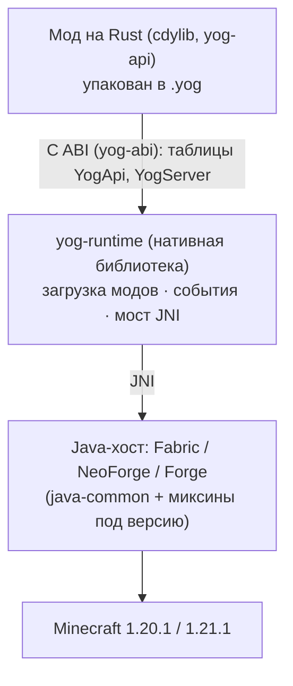

<div align="center">

<a id="top"></a>

# 🗝️ Yog

### Моды для Minecraft на Rust: один файл `.yog` для Fabric, NeoForge и Forge

[](https://crates.io/crates/yog-api)
[](https://docs.rs/yog-api)
[](https://crates.io/crates/yog-cli)
[](https://crates.io/crates/yog-api)
[](LICENSE)
[](LICENSING.md)
[](rust-toolchain.toml)


🇺🇸 [English](README.md) | 🇷🇺 **Русский**

[Обзор](#-обзор) • [Возможности](#-ключевые-возможности) • [Быстрый старт](#-быстрый-старт) • [Примеры](#-примеры) • [CLI](#-утилита-yog) • [Архитектура](#-архитектура) • [Сборка](#-сборка-загрузчика) • [Документация](#-документация)

</div>

---

## 📖 Обзор

**Yog** — загрузчик модов для Minecraft, в котором моды пишутся на **Rust**.
Мод — обычный Rust-крейт поверх [`yog-api`](https://crates.io/crates/yog-api).
`yog build` собирает его сразу под пять платформ и упаковывает всё в один
файл `.yog`. Достаточно положить этот файл в `yog-mods/`, и мод заработает на
**Fabric, NeoForge и Forge**, на Minecraft **1.20.1 и 1.21.1**, под Linux,
Windows и macOS.

Java-часть — тонкая прослойка под каждый загрузчик. Она передаёт игровые
события через JNI в `yog-runtime`, нативную библиотеку, которая загружает
моды. Вся логика модов живёт в Rust.

Название отсылает к Йог-Сототу, «вратам и ключу»: Yog — проход между миром
Java и миром Rust.

<p align="center">
  
</p>

### 🎯 Почему Yog?

- **🦀 Rust вместо Java.** Мод — это Rust-крейт: зависимости из Cargo,
  `cargo test`, проверки компилятора. В коде мода нет ни миксинов, ни маппингов.
- **📦 Один файл на все случаи.** Один и тот же `.yog` работает на трёх
  загрузчиках, двух версиях Minecraft и пяти связках ОС и процессора. Игроку
  нужно просто скопировать файл.
- **🧩 Декларативность.** Экраны описываются разметкой `.yui` с
  компилируемыми привязками, тексты и картинки хранятся в таблицах `.yres`,
  блоки и предметы — в файлах `.yblock`/`.yitem`. Из всего этого генерируется
  Rust-код, и его проверяет компилятор.
- **🛠️ Полноценный инструментарий.** CLI `yog` создаёт, собирает, проверяет,
  импортирует и публикует моды. [Yog-IDLE](https://github.com/F000NKKK/Yog-IDLE)
  добавляет дизайнер экранов, 3D-редактор блоков и предметов с режимом
  рисования, нативный отладчик и горячую перезагрузку.
- **🔓 Свобода для модов.** API-крейты распространяются под
  `MIT OR Apache-2.0`, так что лицензию мода автор выбирает сам. Под AGPL
  только сам движок загрузчика ([LICENSING.md](LICENSING.md)).

## 🌟 Ключевые возможности

### Игровой API
- ✅ **События**: около 25 серверных событий (ломание и установка блоков,
  чат, урон, смерть, взрывы, подбор предметов, контейнеры, снаряды...). Один
  обработчик получает фазу `Pre`, в которой действие можно отменить, и фазу `Post`
- ✅ **Мир, игроки, сущности**: блоки, время, погода, инвентари, NBT,
  эффекты, атрибуты, телепорт между измерениями, частицы, звуки
- ✅ **Команды**: простые и типизированные (`"float float float"`)
- ✅ **Контент**: предметы, блоки, еда, топливо, соединяющиеся блоки
  (трубы, заборы), рецепты верстака, бесформенные и печные, отдельная
  творческая вкладка у каждого мода
- ✅ **Измерения**: свои типы измерений и генераторы чанков на Rust
- ✅ **Сеть**: каналы с сырыми байтами и типизированные структуры `packet!`
- ✅ **Хранение данных**: `Storage` по областям (глобально, на игрока, мир,
  чанк, сущность) и файлы `Config`
- ✅ **Планировщик**: одноразовые и повторяющиеся задачи в тиках
- ✅ **Вызовы между модами**: функция с `#[yog_export]` вызывается из другого
  мода как из обычного крейта ([`yog-interop`](https://crates.io/crates/yog-interop))

### Клиент, графика и интерфейс
- 🎨 **`yog-gfx`**: хуки отрисовки HUD и мира с прямым доступом к GPU
  (буферы, шейдеры, текстуры), 2D-помощник и постоянный кэш скомпилированных шейдеров
- 🪟 **`yog-ui`**: retained-mode интерфейс: flexbox-панели, `Grid` в стиле
  WPF, прокрутка, поля ввода, картинки, фокус. Текст рисуется шрифтом Minecraft
- 🧠 **`yog-kit`**: MVVM для экранов `.yui`: модели представления, привязки
  `{x:Bind}`, команды, списки с шаблонами, стили и визуальные состояния, а
  для юнит-тестов — `TestHost` без игры
- 🧱 **Компоненты**: файлы `.yui` с корнем `<Component>` — свои
  переиспользуемые контролы с типизированными свойствами и событиями
- 🖼️ **Псевдонимы картинок**: `item:apple`, `block:stone`,
  `sprite:icon/heart`, `mod:gui/logo` работают на любой версии игры и любом загрузчике
- 📚 **`yog-book`**: внутриигровые книги в духе Patchouli (9 типов страниц,
  рецепты, макросы, темы, свои шрифты, перевод текстов)
- 📦 **`yog-inventory`**: настоящие экраны контейнеров с произвольной раскладкой слотов

### Ресурсы и контент
- 🌍 **Ресурсы `.yres`**: тексты (с языковыми вариантами вроде
  `Strings.ru_ru.yres`), картинки, звуки, цвета, числа. Один
  `yog_api::resources!()` генерирует типизированные методы доступа
  (`Strings::screen_title()`) и lang-файлы Minecraft
- 🔗 **Ссылки `@Набор.ключ`** работают в `.yui`, в `.yblock`/`.yitem` и в
  `yog.toml` (`name = "@Strings.mod_name"`)
- 🧊 **`.yblock` / `.yitem`**: блок или предмет целиком в одном JSON-файле
  (свойства, модель, состояния, дроп, форма предмета). `yog build` создаёт
  модели, blockstates, таблицы лута, теги и строки перевода, а
  `yog_api::content!()` всё регистрирует
- 📥 **Импорт**: `yog import resourcepack` и `yog import bbmodel` (Blockbench)

### Удобство разработки
- ⚡ **Горячая перезагрузка**: пересобранный мод подменяется в запущенной
  игре через управляющий сокет
- 🐞 **Нативная отладка**: `yog-debugger` (ptrace, DAP) с символами DWARF; им пользуется Yog-IDLE
- 🖥️ **Сборка под 5 платформ**: `cargo-zigbuild` собирает нативы для Linux,
  Windows и macOS на одной машине, а `YOG_TARGETS` ограничивает список платформ
  для быстрой локальной сборки

## 💻 Поддерживаемые платформы

| Загрузчик | Minecraft | Инструменты | Java |
|---|---|---|:---:|
| **Fabric** | 1.20.1 | Yarn 1.20.1+build.10, loader ≥ 0.15.11, fabric-api 0.92.2 | 17 |
| | 1.21.1 | Yarn 1.21.1+build.3, loader ≥ 0.16.9, fabric-api 0.115.6 | 21 |
| **NeoForge** | 1.20.1 | NeoForge 47.1.106 | 17 |
| | 1.21.1 | NeoForge 21.1.77 | 21 |
| **Forge** | 1.20.1 | Forge 47.3.0 | 17 |
| | 1.21.1 | Forge 52.0.40 | 21 |

У каждой пары «загрузчик + версия» свои исходники в `<loader>/platforms/<mc>/`
и свои версии зависимостей в `<loader>/versions/<mc>.properties`. Код, общий
для всех загрузчиков, лежит в `java-common/`. Yog поддерживает релизы `.1`, на
которых обычно останавливается сообщество моддеров. Новая версия Minecraft
добавляется, когда текущие работают стабильно.

Runtime и каждый мод содержат нативы для **linux-x86_64, linux-aarch64,
windows-x86_64, macos-x86_64 и macos-aarch64**.

## 🚀 Быстрый старт

```bash
cargo install yog-cli      # ставит команду `yog`
yog setup                  # таргеты Rust, Zig и cargo-zigbuild для кросс-сборки
yog new my-mod && cd my-mod
yog build                  # -> artifacts/my-mod.yog
```

`yog new` создаёт два файла. `yog.toml` заменяет `Cargo.toml`:

```toml
[mod]
id          = "my-mod"
name        = "My Mod"
version     = "0.1.0"
description = "A Yog mod."
authors     = ["Your Name"]
license     = "MIT OR Apache-2.0"
```

И `src/lib.rs`:

```rust
use yog_api::{Mod, Registry};

pub struct MyMod;

impl Mod for MyMod {
    fn register(registry: &mut Registry) {
        registry.on_server_started(|srv| {
            srv.broadcast("my-mod loaded!");
        });
    }
}

yog_api::export_mod!(MyMod);
```

Скопируйте `artifacts/my-mod.yog` в `<папка игры>/yog-mods/` сборки, где
установлен jar загрузчика Yog. В логе появится:

```
[yog] runtime initialised — the gate is open.
[yog] loaded 1 mod(s) from .../yog-mods
```

> [!NOTE]
> Runtime загружает мод, только если оба собраны с **одной и той же версией
> ABI**. `yog build` берёт свежий `yog-api` с crates.io, и он совпадает со
> свежим опубликованным загрузчиком. Поэтому после обновления загрузчика моды
> нужно пересобрать.

## 📚 Примеры

### События и команды

Один обработчик получает обе фазы. `false` в фазе `Pre` отменяет действие:

```rust
use yog_api::{info, EventPhase, Mod, Registry};

impl Mod for MyMod {
    fn register(r: &mut Registry) {
        r.on_block_break(|e, phase, _srv| {
            if phase == EventPhase::Pre && e.block_id == "minecraft:bedrock" {
                info!("Nice try, {}.", e.player_name);
                return false; // отменить
            }
            true
        });

        r.on_command("hello", |ctx, _srv| Some(format!("Hi, {}!", ctx.source)));

        r.schedule_repeating(1200, |srv| srv.broadcast("Another minute passed."));
    }
}
```

### Экран с моделью представления

Браузер модов из [Yog-Modlist](https://github.com/F000NKKK/Yog-Modlist),
в сокращённом виде. Разметка и привязки описаны в `src/mod_list.yui`:

```xml
<Screen id="yog-modlist:mod_list" width="400" height="224" anchor="center"
        bg="#E0101010" x:ViewModel="ModListVm">
    <Grid w="100%" h="100%" rows="20,*,Auto">
        <Row padding="0 8" gap="4" align="center" bg="#FF222222">
            <Label text="@Strings.screen.title" color="#FFD700" />
            <Spacer flex="1" />
            <Label text="{x:Bind count_text()}" color="#AAAAAA" />
        </Row>
        <Grid Grid.Row="1" rows="14,*" columns="*,*" row_spacing="4" column_spacing="6">
            <TextBox text="{x:Bind search, Mode=TwoWay}" placeholder="@Strings.search.placeholder" />
            <ListView Grid.Row="1" items="{x:Bind visible()}" key="{x:Bind id}"
                      selected="{x:Bind selected_id(), BindBack=select}" item_height="24">
                <ListView.ItemTemplate>
                    <DataTemplate x:DataType="ModEntry">
                        <Label text="{x:Bind name}" selected:color="#FFD700" />
                    </DataTemplate>
                </ListView.ItemTemplate>
            </ListView>
        </Grid>
        <Button Grid.Row="2" halign="right" text="@Strings.screen.done" command="{x:Bind cx.close()}" />
    </Grid>
</Screen>
```

Код к экрану (`src/mod_list.rs`) — обычная структура. Привязки вызывают её
методы, и компилятор проверяет каждый вызов:

```rust
yog_api::ui_include!("mod_list");          // сгенерированный .g.rs
use crate::res::Strings;
use yog_kit::prelude::*;

#[derive(Default)]
pub struct ModListVm { mods: Vec<ModEntry>, search: String, selected: Option<String> }

impl ViewModel for ModListVm {
    fn on_open(&mut self, _cx: &mut Cx<'_, Self>) {
        if self.mods.is_empty() { self.mods = load_mods(); }
    }
}

impl ModListVm {
    pub fn visible(&self) -> impl Iterator<Item = &ModEntry> + '_ { /* фильтр по поиску */ }
    pub fn count_text(&self) -> String { Strings::screen_count(self.mods.len()) }
    pub fn select(&mut self, id: String) { self.selected = Some(id); }
}
```

```rust
// lib.rs
mod_list::register(registry);
registry.register_menu_entry(Strings::MENU_BUTTON_KEY, mod_list::ID);
```

Прокрутка, фокус, навигация с клавиатуры и ввод текста работают без
дополнительного кода. Подробнее: [экраны `.yui`](https://github.com/F000NKKK/Yog-IDLE/blob/master/docs/yui.md)
и [экраны с моделью представления](https://github.com/F000NKKK/Yog-IDLE/blob/master/docs/mvvm.md).

### Ресурсы и перевод

В `resources/Strings.yres` лежат английские тексты, а в `Strings.ru_ru.yres`
под теми же именами — русские:

```json
{
  "mod_name": { "value": "Yog Mod List", "comment": "Shown in mod lists" },
  "screen.count": { "value": "{count} mods", "comment": "{count} = number of mods" },
  "menu.button": "Yog Mods"
}
```

```rust
yog_api::resources!();               // один раз в lib.rs: генерирует `crate::res`
use res::Strings;

Strings::screen_count(42)            // "42 mods" или "Модов: 42" — на языке игрока
Strings::MENU_BUTTON_KEY             // ключ перевода, для API, которым нужен ключ
```

`yog.toml` может ссылаться на те же тексты: `name = "@Strings.mod_name"`.
Подробнее: [ресурсы `.yres`](https://github.com/F000NKKK/Yog-IDLE/blob/master/docs/yres.md).

### Блоки и предметы в файлах

Настоящий предмет из [HexMod-Yog](https://github.com/F000NKKK/HexMod-Yog),
`content/items/amethyst_dust.yitem`:

```json
{
  "name": "@Items.amethyst_dust",
  "tooltip": "@Items.amethyst_dust.desc",
  "model": { "parent": "generated", "textures": { "layer0": "item/amethyst_dust.png" } }
}
```

```rust
yog_api::content!();   // в lib.rs: регистрирует все блоки и предметы из content/
```

`yog build` создаёт модель предмета, строки перевода и Rust-код
(`content::Items::AMETHYST_DUST`). Для блоков дополнительно генерируются
blockstates, таблицы лута и теги добычи. Подробнее: [блоки и предметы](https://github.com/F000NKKK/Yog-IDLE/blob/master/docs/blocks-items.md).

### Вызов другого мода

[Yog-Pipes](https://github.com/F000NKKK/Yog-Pipes) экспортирует свой API
через `#[yog_export]`. Другой мод подключает его в `yog.toml`:

```bash
yog add --mod yog-pipes        # добавит его в [dependencies.exports]
```

```rust
use yog_pipes::{broadcast, PipePayload, PipePos};

broadcast(
    PipePos { dim: "minecraft:overworld".into(), x: 0, y: 64, z: 0 },
    PipePayload { data: vec![15], metadata: vec![] },
).unwrap();
```

Вызов сериализуется через rkyv и проходит через runtime, поэтому два
`cdylib` друг с другом не линкуются. Экспортирующий мод публикует крейт с
привязками командой `yog publish exports`.

## 🧰 Утилита `yog`

| Команда | Что делает |
|---|---|
| `yog new <name>` | Создать проект мода |
| `yog build` / `yog build debug` | Собрать под все платформы и упаковать `artifacts/<id>.yog` (`debug` сохраняет отладочную информацию для отладчика) |
| `yog check` | Сгенерировать `.yog-build/` и выполнить `cargo check` для текущей машины |
| `yog run <config> [--debug]` | Собрать, скопировать `.yog` в игровую сборку и запустить её (`[run.<config>]` в `yog.toml`) |
| `yog ui gen` | Сгенерировать `.g.rs` из экранов и компонентов `.yui` |
| `yog res check` | Проверить `.yres`, перегенерировать методы доступа, показать непереведённые тексты |
| `yog content check` | Проверить `.yblock`/`.yitem`, перегенерировать `yog-content.g.rs` |
| `yog import resourcepack <zip\|dir>` | Превратить модели блоков и предметов из ресурспака в файлы `content/` |
| `yog import bbmodel <file>` | Превратить модель Blockbench в файл `content/` |
| `yog add` / `yog remove <crate>` | Изменить `[dependencies]`; с `--mod` — `[dependencies.exports]` |
| `yog publish exports` | Опубликовать `#[yog_export]` API мода на crates.io |
| `yog setup` / `yog doctor [--json]` | Установить зависимости сборки или показать, чего не хватает |
| `yog designer-lib` | Собрать мод только для этой машины (нужно дизайнеру Yog-IDLE) |

`YOG_TARGETS=linux-x86_64` (теги или триплеты через запятую) ограничивает
сборку указанными платформами. `YOG_API_PATH` или `[dev] yog_api_path` в
`yog.toml` подключают локальный `yog-api` вместо версии с crates.io.

## 📐 Архитектура



- **Хост тонкий.** Он распаковывает натив runtime, вшитый в jar загрузчика
  (`natives/<os>-<arch>/`), подписывается на события загрузчика и передаёт
  их через JNI.
- **Моды загружаются динамически** из `<папка игры>/yog-mods/`. Файл `.yog` —
  это zip с `natives/<os>-<arch>/`, сгенерированными `assets/` и `data/` и
  манифестом. Runtime сам выбирает натив под текущую машину.
- **ABI версионирован** (`ABI_MAJOR * 10000 + ABI_MINOR` в `yog-abi`). Мод
  загружается, только если его версия ABI совпадает с версией runtime.
- **У каждого события есть фаза** (`Pre`/`Post`), поэтому одна регистрация
  покрывает обе стороны действия.

### Крейты

Все крейты лежат в `rust/crates/` и опубликованы на crates.io. Моды зависят
от `yog-api` (и от `yog-kit`, если нужны экраны с моделью представления).
Остальные API-крейты реэкспортируются через `yog-api`.

| Крейт | Назначение | Лицензия |
|---|---|---|
| [`yog-api`](https://crates.io/crates/yog-api) | Фасад для модов: `Mod`, `Registry`, `export_mod!`, `resources!`, `content!`, `ui_include!` | MIT/Apache |
| [`yog-kit`](https://crates.io/crates/yog-kit) | MVVM-фреймворк для экранов `.yui` | MIT/Apache |
| [`yog-ui`](https://crates.io/crates/yog-ui) | Виджеты, flexbox и `Grid`, отрисовка | MIT/Apache |
| [`yog-gfx`](https://crates.io/crates/yog-gfx) | Доступ к GPU, 2D-рисование, источники картинок | MIT/Apache |
| [`yog-book`](https://crates.io/crates/yog-book) | Внутриигровые книги | MIT/Apache |
| `yog-core`, `yog-event`, `yog-world`, `yog-player`, `yog-entity`, `yog-registry`, `yog-command`, `yog-network`, `yog-storage`, `yog-config`, `yog-logging`, `yog-dimensions`, `yog-inventory`, `yog-interop` | Предметные крейты за `yog-api` | MIT/Apache |
| [`yog-abi`](https://crates.io/crates/yog-abi) | `#[repr(C)]`-контракт между модами и runtime | MIT/Apache |
| [`yog-cli`](https://crates.io/crates/yog-cli) | Команда `yog` | MIT/Apache |
| [`yog-runtime`](https://crates.io/crates/yog-runtime) | Движок: мост JNI, загрузка модов, события, управляющий сокет | AGPL |
| `yog-hot-reload`, `yog-debugger`, `yog-symbols` | Горячая перезагрузка, отладчик на ptrace/DAP, поиск по DWARF | AGPL |

## 🔧 Сборка загрузчика

Понадобятся Rust (версия закреплена в `rust-toolchain.toml`, rustup сам
поставит тулчейн и все пять таргетов), `cargo-zigbuild` с Zig для
кросс-сборки, а для Gradle — JDK 17 и 21. `build.sh` выбирает JDK по
`<loader>/versions/<mc>.properties`.

```bash
./build.sh build                          # runtime под все платформы + jar всех загрузчиков
./build.sh build fabric --mc 1.21.1       # один загрузчик, одна версия Minecraft
./build.sh run fabric --client            # собрать и запустить dev-клиент Fabric
./build.sh run neoforge --client --mc 1.21.1
./build.sh test                           # cargo test
./build.sh publish fabric                 # релизный jar -> artifacts/fabric/
YOG_TARGETS=linux-x86_64 ./build.sh build # только текущая платформа, гораздо быстрее
```

Dev-сборки берут моды из `<loader>/run/yog-mods/`. При первом запуске
сервера поставьте `eula=true` в `<loader>/run/eula.txt`.

### Горячая перезагрузка

Если игра запущена с переменной `YOG_CONTROL_SOCKET=<путь>`, runtime открывает
по этому пути Unix-сокет (Linux и macOS). Сокет понимает `{"cmd":"list_mods"}`
и `{"cmd":"hot_reload","mod_id":"my-mod","yog_path":"/abs/path/my-mod.yog"}`.
Вторая команда подменяет натив мода на лету. ABI новой сборки должен точно
совпадать с ABI runtime, поэтому мод нужно собирать против того же чекаута
(`YOG_API_PATH`). Yog-IDLE делает всё это сам, из панели запуска.

## 📖 Документация

| Тема | Где |
|---|---|
| Весь Rust API | [docs.rs/yog-api](https://docs.rs/yog-api), [docs.rs/yog-kit](https://docs.rs/yog-kit), [docs.rs/yog-ui](https://docs.rs/yog-ui) |
| Экраны `.yui`, `Grid`, картинки, компоненты | [Yog-IDLE/docs/yui.md](https://github.com/F000NKKK/Yog-IDLE/blob/master/docs/yui.md) |
| Экраны с моделью представления (yog-kit) | [Yog-IDLE/docs/mvvm.md](https://github.com/F000NKKK/Yog-IDLE/blob/master/docs/mvvm.md) |
| Ресурсы `.yres` и перевод | [Yog-IDLE/docs/yres.md](https://github.com/F000NKKK/Yog-IDLE/blob/master/docs/yres.md) |
| Контент `.yblock` / `.yitem` | [Yog-IDLE/docs/blocks-items.md](https://github.com/F000NKKK/Yog-IDLE/blob/master/docs/blocks-items.md) |
| Проектные заметки по yog-kit | [docs/design/yog-kit.md](docs/design/yog-kit.md) |
| Устройство инвентарей | [rust/crates/yog-inventory/DESIGN.md](rust/crates/yog-inventory/DESIGN.md) |
| Лицензирование | [LICENSING.md](LICENSING.md) |

Документация в Yog-IDLE и docs.rs написана на английском.

## 🌐 Экосистема Yog

| Проект | Что это |
|---|---|
| **Yog-Mod-Loader** (этот репозиторий) | Хосты загрузчика, runtime, API-крейты, CLI `yog` |
| [Yog-IDLE](https://github.com/F000NKKK/Yog-IDLE) | IDE для модов Yog: дизайнер экранов, 3D-редактор блоков и предметов, отладчик, горячая перезагрузка |
| [Substrate-Platform](https://github.com/F000NKKK/Substrate-Platform) | Универсальное ядро IDE, на котором построен Yog-IDLE |
| [Yog-Modlist](https://github.com/F000NKKK/Yog-Modlist) | Список модов в игре; эталонный экран с моделью представления |
| [Yog-Pipes](https://github.com/F000NKKK/Yog-Pipes) | Сети труб, которым всё равно, что по ним передаётся, — для других модов |
| [HexMod-Yog](https://github.com/F000NKKK/HexMod-Yog) | Порт Hex Casting на Yog |

## 🚧 Статус

Yog **активно разрабатывается**, и API пока не заморожен. Обратной
совместимости между версиями нет: старые API и форматы удаляются сразу, без
периода устаревания. Ядро готово и работает на всех шести парах «загрузчик +
версия», а API продолжает расти.

## 📄 Лицензия

Лицензия разделена: загрузчик остаётся свободным, а моды могут выбирать любую
лицензию (подробнее в [LICENSING.md](LICENSING.md)):

- **Движок загрузчика**: Java-хосты, `yog-runtime`, `yog-hot-reload`,
  `yog-debugger` и `yog-symbols` — **AGPL-3.0-only** ([LICENSE](LICENSE)).
- **Крейты для модов**: `yog-api`, `yog-kit`, предметные крейты и `yog-cli` —
  **MIT OR Apache-2.0** ([LICENSE-MIT](LICENSE-MIT), [LICENSE-APACHE](LICENSE-APACHE)).

---

<div align="center">

**[⬆ Наверх](#top)**

Свободный и открытый проект, без платных тарифов.

</div>
